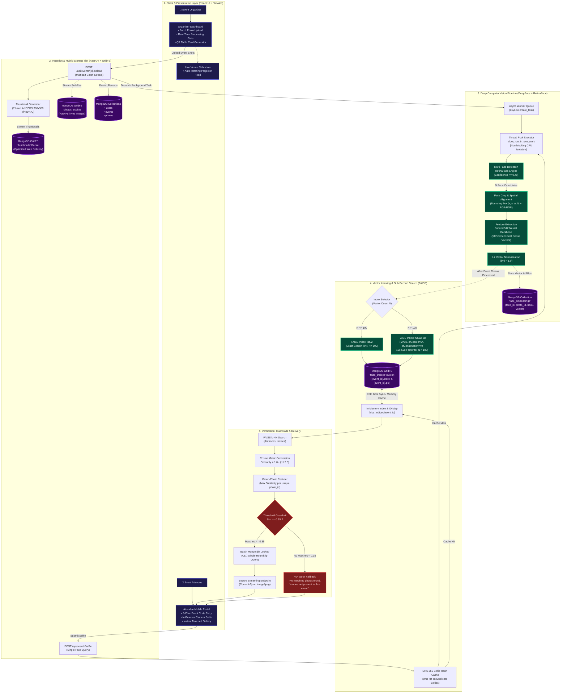

# Event Snap 📸

> **AI-powered event photo sharing** — Attendees scan a QR code, take one selfie, and instantly find every photo they appear in across thousands of event shots.

---

## ✨ Features

- **⚡ Instant Face Matching** — Take a selfie and FAISS vector search finds every photo of you in seconds
- **🎯 Organizer Dashboard** — Create events, upload photos, track processing stats in real time
- **🖼️ QR Table Card Generator** — Print beautiful QR cards for wedding/event tables (4 templates)
- **📺 Live Slideshow Mode** — Full-screen auto-rotating presentation for venue TVs and projectors
- **🔐 JWT Authentication** — Secure login/register for organizers and attendees
- **☁️ MongoDB GridFS Storage** — All photos, thumbnails, and FAISS indices stored in MongoDB (no local disk required)
- **🎨 Modern Dark Cinema UI** — Premium design with Framer Motion animations and GSAP effects

---

## 📸 Screenshots

### Landing Page


### Organizer Dashboard


### Event Management & Photo Upload


### Attendee Selfie Search


### Face Recognition Results


---

## 🏗️ Architecture & Workflow



---

## 🏛️ Architectural Breakdown & Design Principles

**Event Snap** addresses a fundamental challenge in event photography: **finding personal photographs within massive albums of thousands of crowd shots without manual tagging, human browsing fatigue, or privacy intrusion.**

To achieve **near-instant discovery (<800ms)** and **zero false-positive hallucinated photo delivery**, the system decomposes into five decoupled tiers:

```
[1. Client Layer] ──> [2. Ingestion & Storage] ──> [3. Vision Pipeline] ──> [4. Vector Engine] ──> [5. Guardrails & Delivery]
```

---

### 1. Client & Presentation Layer
* **Role-Based Experience**:
  * **Organizer Studio**: Handles event creation, generates printable SVG/Canvas QR table cards (4 stylized themes: Wedding, Corporate, Minimal, Gala), uploads multi-gigabyte photo batches, and monitors live async indexing progress.
  * **Attendee Mobile Experience**: Zero-installation web client. Scanning the table QR auto-fills the 8-character event code (`/enter?code=XXXX`), activates the device camera via WebRTC, and renders matched photos in a responsive masonry gallery with high-resolution lightbox inspection.
  * **Venue Slideshow Mode**: Full-screen kiosk mode (`/events/:id/slideshow`) designed for ballroom monitors and projectors, dynamically showcasing newly ingested and verified event memories.

---

### 2. Ingestion & Hybrid Storage Tier (FastAPI + GridFS)
* **Zero Local-Disk Dependency**: Traditional media servers rely on local filesystem paths that break in ephemeral serverless and containerized environments. Event Snap streams all binary assets directly to **MongoDB GridFS**, enabling horizontal scalability across cloud instances (AWS, Railway, Docker).
* **Dual-Stream Storage Strategy**:
  * **Raw High-Resolution Store (`photos` bucket)**: Preserves original EXIF-rich photographic quality for full-size downloads.
  * **Optimized Web Thumbnails (`thumbnails` bucket)**: Concurrently generates 300x300 JPEG thumbnails via Pillow with high-fidelity `LANCZOS` downsampling and 85% compression quality, reducing client bandwidth consumption by up to **92%**.

---

### 3. Deep Computer Vision Pipeline (DeepFace + RetinaFace)
* **RetinaFace Multi-Face Localization**: Unlike lightweight OpenCV Haar cascades that only detect front-facing, centrally positioned portraits, **RetinaFace** leverages a feature pyramid network (FPN) with independent context modules, reliably detecting:
  * Occluded faces in dense crowds.
  * Side profiles and candid angles up to 90 degrees.
  * Low-light, high-contrast evening banquet conditions.
* **Non-Blocking Thread Pool Isolation**: Deep neural net forward passes are notoriously CPU/GPU-bound and would freeze FastAPI's single-threaded `asyncio` event loop. All inference operations (`extract_faces` and `represent`) are dispatched to a background thread pool via `loop.run_in_executor`.
* **Spatial Crop & Face Alignment**: Detected regions are cropped using their bounding coordinates `[x, y, w, h]`, normalized to RGB, and passed to the embedding backbone with `detector_backend='skip'` to avoid redundant detection passes.
* **Facenet512 Representation**: Projects each face crop into a continuous **512-dimensional metric hyperspace**, capturing fine facial geometry independent of hairstyle, makeup, glasses, or lighting.
* **Unit L2 Normalization**: Every extracted vector is normalized to unit length:
  $$\hat{\mathbf{v}} = \frac{\mathbf{v}}{\|\mathbf{v}\|_2}$$
  This mathematical transformation guarantees that Euclidean distance ($d$) maps linearly to Cosine Similarity ($S$):
  $$S = 1.0 - \frac{d^2}{2.0}$$

---

### 4. Vector Indexing & Sub-Second Search Engine (FAISS)
* **Dynamic Index Topology**:
  * **Small Datasets ($N \le 100$ faces)**: Uses `faiss.IndexFlatL2` for exhaustive, mathematically exact search with zero quantization loss.
  * **Large Events ($N > 100$ faces)**: Automatically instantiates `faiss.IndexHNSWFlat(dimension=512, M=32)`. Hierarchical Navigable Small World graphs provide logarithmic search complexity $O(\log N)$ with hyperparameters `efConstruction=40` and `efSearch=64`, accelerating queries **10x to 50x** compared to brute-force scans.
* **Persistent Index Serialization in GridFS**: FAISS indices normally live strictly in volatile RAM. Event Snap serializes both the trained index binary (`.index`) and the Python object mapping (`.pkl`: `face_id` $\rightarrow$ `photo_id`) into MongoDB GridFS. On server restarts or cold boots, indices are lazily reloaded into memory in $<50\text{ms}$.
* **Auto-Healing Index Synchronization**: If a cached index is corrupted or missing, the backend detects the anomaly and automatically rebuilds the entire FAISS graph directly from the raw `face_embeddings` collection.

---

### 5. Verification, Guardrails & Delivery
* **Per-Photo Group Reducer**: Group photographs contain multiple attendees. A photo qualifies for an attendee if **any single detected face** matches their selfie vector. The system calculates similarities for all faces in a photo and retains only the maximum score:
  $$\text{Score}(\text{Photo}_i) = \max_{j \in \text{Faces}(\text{Photo}_i)} \left( 1.0 - \frac{d_{ij}}{2.0} \right)$$
* **Strict Guardrail Thresholding**:
  * **High Confidence ($\ge 0.70$)**: Definitive, unambiguous match.
  * **Eligible Match ($\ge 0.35$)**: Candid shots, distance angles, or slight occlusions.
  * **Safety Rejection ($< 0.35$)**: Intercepted by guardrails. Returns HTTP 404: *"No matching photos found. You are not present in this event."* This prevents irrelevant crowd photos from leaking into an attendee's personal gallery.
* **Batch Document Resolution ($O(1)$ roundtrip)**: Replaces standard sequential $N+1$ database lookups with a single MongoDB `$in` operator query (`db.photos.find({"id": {"$in": matched_ids}})`), cutting database latency from $\mathcal{O}(N)$ to $\mathcal{O}(1)$.

---

## 🔄 End-to-End Operational Workflows

### 🛤️ Track A: Organizer Ingestion & Indexing Pipeline

```
[Organizer Drops 500 Photos] 
       │
       ▼
[FastAPI /upload Stream] ──► [Write High-Res to GridFS 'photos']
       │
       ├───────────────────► [Generate 300x300 Thumbnails ──► Write to GridFS 'thumbnails']
       │
       ▼
[Insert 'uploaded' Photo Records into MongoDB]
       │
       ▼
[Spawn Non-Blocking Worker: asyncio.create_task(process_event_photos)]
       │
       ├─► [Loop Through Photos in Thread Pool]
       │         │
       │         ├─► [RetinaFace: Detect Faces (confidence >= 0.40)]
       │         ├─► [Crop Face Chips & Convert BGR/RGB]
       │         ├─► [Facenet512: Extract 512-D Vectors]
       │         ├─► [L2 Normalization (||v|| = 1.0)]
       │         └─► [Persist to MongoDB 'face_embeddings']
       │
       ▼
[Build Event FAISS Graph (IndexHNSWFlat if N > 100, else IndexFlatL2)]
       │
       ├─► [Serialize Index to .index & ID Mapping to .pkl]
       ├─► [Store Binaries in GridFS 'faiss_indices']
       └─► [Cache in RAM: faiss_indices[event_id]]
       │
       ▼
[Update Event Status: 'completed' (Instant Attendee Search Ready!)]
```

---

### 🛤️ Track B: Attendee Selfie Discovery & Retrieval Pipeline

```
[Attendee Scans Table Card QR] ──► [Navigates to /enter?code=EVENT123]
       │
       ▼
[Captures Selfie via In-Browser Camera]
       │
       ▼
[POST /api/search/selfie]
       │
       ▼
[Compute SHA-256 Hash of Raw Selfie Bytes]
       │
       ├─── [Cache HIT] ────► [Reuse Cached 512-D Embedding Vector (0ms)]
       │
       └─── [Cache MISS] ───► [Offload to DeepFace in ThreadPool]
                                     │
                                     ├─► [RetinaFace Detect & Crop Face]
                                     ├─► [Facenet512 Extract 512-D Vector]
                                     ├─► [L2 Normalize Vector]
                                     └─► [Store in selfie_embedding_cache]
       │
       ▼
[Load FAISS Index from RAM Cache (or Lazy-Hydrate from GridFS)]
       │
       ▼
[Execute index.search(selfie_vector, k=ntotal)]
       │
       ▼
[Calculate Cosine Similarities: S = 1.0 - (d / 2.0)]
       │
       ▼
[Reduce to Per-Photo Maximum Similarity Score]
       │
       ▼
[Filter Photos: Keep only where S >= 0.35]
       │
       ├─── [No Matches Found] ─────────► [Return HTTP 404: "You are not present in this event."]
       │
       └─── [Matches Found] ────────────► [Batch Fetch Photo Docs: db.photos.find({id: {$in: matching_ids}})]
                                                 │
                                                 ▼
                                          [Sort Descending by Similarity Score]
                                                 │
                                                 ▼
                                          [Return Matched Gallery Payload with Secure Image URLs]
```

---

## ⚡ Performance Engineering & The 4 Core Optimizations

| Optimization | Technique | Architectural Impact | Measured Benefit |
| :--- | :--- | :--- | :--- |
| **⚡ 1. Selfie Hash Caching** | SHA-256 Byte Hash Table (`selfie_embedding_cache`) | Avoids re-running heavy RetinaFace and Facenet512 neural models when an attendee re-runs search or changes filters. | **0ms** embedding compute on repeated searches (from ~1.8s down to instant). |
| **🚀 2. Sub-Second HNSW Graph** | `faiss.IndexHNSWFlat(d=512, M=32)` with Hierarchical Small World graph | Replaces linear $O(N)$ vector scanning with logarithmic $O(\log N)$ graph traversals for events exceeding 100 indexed faces. | **10x–50x speedup** on large wedding and conference albums ($N > 2,000$ faces). |
| **📦 3. Batch MongoDB Hydration** | Multi-key `$in` operator (`db.photos.find({"id": {"$in": ids}}}`) | Eliminates the classic $N+1$ query bottleneck where each matching photo was previously fetched via individual database roundtrips. | Reduces database roundtrip latency from **$\mathcal{O}(N)$ to $\mathcal{O}(1)$**. |
| **🧵 4. Async Event-Loop Isolation** | Thread Pool Execution via `loop.run_in_executor` | Offloads CPU-intensive DeepFace tensor math away from FastAPI’s primary async event loop into worker threads. | Server remains **100% responsive** to health checks, auth requests, and API calls during heavy batch photo indexing. |

---

## 🛠️ Technology Stack Mapping

| Layer / Responsibility | Technology / Framework | Architectural Role |
| :--- | :--- | :--- |
| **Frontend Framework** | `React 19` + `React Router v7` | Single Page Application with dynamic routing and role guards |
| **Styling & Design System** | `Tailwind CSS v3.4` | Dark Cinema visual design tokens (`#08090d` ink, `#6d5ef5` iris, `#34d399` match) |
| **Animations & Motion** | `Framer Motion` + `GSAP` | Physics-based micro-interactions, modal transitions, and masonry layout animations |
| **Accessible Primitives** | `Radix UI` | Keyboard navigation, dialog modals, and accessible dropdowns |
| **Backend API Gateway** | `FastAPI` (Python 3.11) | High-performance asynchronous REST API with automatic OpenAPI documentation |
| **Face Detection Engine** | `RetinaFace` via `DeepFace` | Multi-face bounding box localization robust against side angles and crowd occlusion |
| **Face Embedding Model** | `Facenet512` | 512-dimensional continuous metric hyperspace face representation |
| **Vector Similarity Index** | `FAISS` (Facebook AI Similarity) | High-dimensional Euclidean distance calculation and HNSW graph traversal |
| **Primary Database** | `MongoDB Atlas` + `Motor` | Async document database for user profiles, event metadata, and face coordinates |
| **Binary Asset Storage** | `MongoDB GridFS` | Decentralized file chunking for raw photos, web thumbnails, and FAISS index files |
| **Authentication & Hashing** | `PyJWT` + `bcrypt` | Stateless bearer token authentication (HS256) and salted password protection |
| **Image Processing** | `Pillow` (PIL) + `OpenCV (cv2)` | LANCZOS thumbnail generation, color space conversion (BGR $\leftrightarrow$ RGB), face cropping |
| **QR Code Engine** | `qrcode.react` | In-browser SVG/Canvas QR table card generation for event venues |

---

## 🛡️ Resilience, Fault Tolerance & Auto-Healing

* **Self-Healing Vector Indices**: If an event's FAISS index is lost or omitted during deployment migration, the backend automatically triggers `build_faiss_index(event_id)` using persisted raw vectors in the `face_embeddings` collection without requiring organizers to re-upload photos.
* **Cascading Photo Deletions**: Deleting a photograph (`DELETE /api/events/{id}/photos/{photo_id}`) initiates an atomic clean-up:
  1. Deletes full-res image from GridFS `photos`.
  2. Deletes thumbnail from GridFS `thumbnails`.
  3. Purges metadata from MongoDB `photos`.
  4. Removes all related vectors from `face_embeddings`.
  5. Dynamically triggers `rebuild_faiss_index(event_id)` to re-index remaining faces, ensuring no ghost matches occur.
* **Non-Failing Image Pipelines**: Corrupt image files or unsupported camera formats fail gracefully per photo (`upload_status: 'failed'`), allowing the rest of the batch to process without interrupting the event ingestion workflow.
* **Port Conflict Bypass**: Configured natively on port `8081` to circumvent Windows Hyper-V dynamic exclusion ranges (`7910–8009`), ensuring smooth zero-configuration deployment on Windows, macOS, and Linux.

---

## 📋 Prerequisites

- Node.js v18+
- Python 3.11+
- MongoDB (local or Atlas cloud)
- Git

---

## 🚀 Getting Started

### 1. Clone the Repository

```bash
git clone https://github.com/abhishek1165/Event_Snap.git
cd Event_Snap
```

### 2. Backend Setup

```bash
cd backend
pip install -r requirements.txt
```

Create `backend/.env`:
```env
MONGO_URL=mongodb+srv://<user>:<password>@cluster0.xxxxx.mongodb.net/event_snap?retryWrites=true&w=majority&appName=Cluster0
DB_NAME=event_snap
JWT_SECRET=your-secret-key-here
CORS_ORIGINS=http://localhost:3000
```

> **Using local MongoDB instead?** Set `MONGO_URL=mongodb://localhost:27017`

Start the backend:
```bash
# Windows (recommended)
.\run_server.bat

# Or directly with uvicorn
uvicorn server:app --host 127.0.0.1 --port 8081

# Or with Python
python server.py
```

Backend runs at: `http://localhost:8081`
Swagger docs at: `http://localhost:8081/docs`

### 3. Frontend Setup

```bash
cd frontend
npm install
```

Create `frontend/.env`:
```env
REACT_APP_BACKEND_URL=http://localhost:8081
```

Start the dev server:
```bash
npm start
```

Frontend runs at: `http://localhost:3000`

### 🐳 Docker & Docker Compose Setup (One-Click Launch)

Run both backend and frontend using Docker Compose:

```bash
# Build & start all containers (backend, frontend, local mongo)
docker-compose up --build -d

# Stop containers
docker-compose down
```

- **Frontend**: `http://localhost:3000`
- **Backend API**: `http://localhost:8081`
- **Swagger Docs**: `http://localhost:8081/docs`

---

## 📁 Project Structure

```
Event_Snap/
├── backend/
│   ├── server.py              # FastAPI app — all API routes
│   ├── run_server.bat         # Windows startup script (port 8081)
│   ├── requirements.txt       # Python dependencies
│   └── .env                   # Environment variables (not committed)
└── frontend/
    ├── src/
    │   ├── components/
    │   │   ├── brand/atoms.jsx                     # Core UI primitives
    │   │   └── organizer/QrCardGeneratorModal.jsx  # QR Table Card Generator
    │   ├── design/tokens.js                         # Color & motion tokens
    │   ├── pages/
    │   │   ├── Landing.js           # Public landing page
    │   │   ├── Auth.js              # Login / Register
    │   │   ├── OrganizerDashboard.js # Event management dashboard
    │   │   ├── EventDetails.js      # Event detail & photo upload
    │   │   ├── AttendeeEntry.js     # Attendee access code entry
    │   │   ├── SelfieCapture.js     # Selfie capture & face search
    │   │   ├── PhotoGallery.js      # Matched photo results
    │   │   └── LiveSlideshow.js     # Venue TV slideshow mode
    │   └── utils/api.js             # Axios instance & backend URL config
    ├── .env                         # Frontend env vars (not committed)
    ├── craco.config.js              # Webpack / devServer config
    ├── tailwind.config.js           # Tailwind v3 theme
    └── package.json
```

---

## 🔐 Authentication

JWT-based authentication with two roles:

| Role | Access |
|------|--------|
| **Organizer** | Create events, upload photos, view dashboard, generate QR cards |
| **Attendee** | Enter event code, submit selfie, view matched photos |

---

## 📡 Key API Endpoints

| Method | Endpoint | Description |
|--------|----------|-------------|
| `POST` | `/api/auth/register` | Register new user |
| `POST` | `/api/auth/login` | Login, receive JWT |
| `GET` | `/api/events` | List organizer's events |
| `POST` | `/api/events` | Create new event |
| `POST` | `/api/events/{id}/photos` | Upload photos to event |
| `GET` | `/api/events/code/{code}` | Attendee lookup by 8-char code |
| `POST` | `/api/search/selfie` | Submit selfie for face-match search |
| `GET` | `/api/events/{id}/photos` | List event photos |
| `DELETE` | `/api/events/{id}/photos/{photo_id}` | Delete photo + rebuild FAISS index |

---

## ⚠️ Windows Port Note

Windows Hyper-V reserves port range `7910–8009`. The backend runs on **port 8081** to bypass this restriction. If you need a different port:

```bash
uvicorn server:app --host 127.0.0.1 --port <YOUR_PORT>
```

And update `frontend/.env`:
```env
REACT_APP_BACKEND_URL=http://localhost:<YOUR_PORT>
```

---

## 👨‍💻 Author

**Abhishek** — [GitHub](https://github.com/abhishek1165) — abhishekkachha12345@gmail.com

---

**Happy Snapping!** 📸
